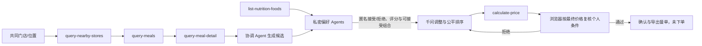

# 麦当劳 MCP 接入说明

## 1. 接入目标

当前已实现官方 MCP 只读客户端、千问协调 Agent 与实时网页。网页经本地 Node.js API 读取真实菜单，模型按浏览器反馈迭代餐单，最终重新官方核价。角色和边界见 README。

SecretTable 使用麦当劳 MCP 的在售菜单、单品详情、营养信息与官方核价作为协商依据。千问提出方案，浏览器本地条件评估器判断接受与否，最后重新核价与复核个人预算。当前只确认与导出餐单，不执行交易写操作。

服务地址：`https://mcp.mcd.cn`  
传输协议：Streamable HTTP  
认证方式：`Authorization: Bearer ${MCD_MCP_TOKEN}`

仓库中的 `mcp-config.example.json` 只包含环境变量占位符。真实 Token 不进入浏览器、不进入日志、不进入 Git 历史。

## 2. 已验证工具与目标工具

2026-10-15 的真实联调调用了 `now-time-info`、`list-nutrition-foods`、`query-nearby-stores`、`query-meals`、`query-meal-detail`、`calculate-price`。门店返回 117 个不重复餐品编码，营养接口返回 160 条记录，三份测试单品报价 6300 分（63 元）。证据见 [evidence/live-readonly.json](./evidence/live-readonly.json)。`query-store-coupons` 尚未验证；任何下单、取消和兑换工具均未执行。

已实现流程使用 `now-time-info`、`list-nutrition-foods`、`query-nearby-stores`、`query-meals`、`query-meal-detail`、`calculate-price`。下表中优惠券与交易部分为未来扩展，当前不执行：

| 工具 | 阶段 | 用途 | 安全级别 |
|---|---|---|---|
| `query-nearby-stores` | 建桌 | 确认共同可用门店 | 只读 |
| `query-meals` | 候选生成 | 获取当前门店真实可售餐品 | 只读 |
| `query-meal-detail` | 候选生成 | 核实单品名称与结构，跳过需要配置套餐子项的商品 | 只读 |
| `list-nutrition-foods` | 私密评估 | 在偏好 Agent 内判断营养硬约束 | 只读 |
| `query-store-coupons` | 未来扩展 | 当前未集成到协商链路 | 只读 |
| `calculate-price` | 决选 | 对最终候选做官方核价 | 只读试算 |
| `create-order` | 未来扩展 | 当前无执行路径 | 写操作，始终阻断 |
| `cancel-order` | 未来扩展 | 当前无执行路径 | 写操作，始终阻断 |

## 3. 调用流程



## 4. 本地真实连接

安装依赖后，可直接读取已配置的 Windows 用户或系统环境变量。也可在 PowerShell 7 的当前终端设置：

```powershell
$env:MCD_MCP_TOKEN = Read-Host "请粘贴 MCP Token" -MaskInput
npm run mcp:inspect
npm run mcp:verify
```

调用只读工具：

```powershell
npm run mcp:call -- --tool now-time-info --input '{}'
```

`server/live-readonly.ts` 使用明确的只读工具允许列表。误传 `create-order` 或未审查的新工具时，在连接服务器之前拒绝执行。公开联调报告只保存门店名称、公开餐品及计价结果、计数、时间与 traceId，不保存原始响应、Token 或账户信息。

## 5. 业务价值

- 真实：不让大模型编造菜单、供应状态或价格。
- 隐私：参与者无需在群聊里公开预算、忌口或营养边界。
- 公平：使用 max-min 原则提高最低满意度，不让少数人被多数票吞掉。
- 可控：当前不存在交易写接口，仅支持确认与导出餐单。
- 可审计：公开轨迹只记录工具名、候选编号与匿名信号，不记录原始私人条件。

## 6. Demo 与真实模式的边界

网页默认“真实协商”：通过本地 API 获取门店、菜单、详情、营养和价格，千问接收公开上下文并调用 `submit_table_proposals`；浏览器独立评估，第二轮起提交匿名结果和自愿的可接受餐品组合。最多三轮。模型从已核实菜单选择商品，不能写入价格；最终核价后浏览器再次验证个人预算。

网页另提供“离线演示”，仅使用固定 fixture，不会静默替换真实调用。完整 API 链路可用 `npm run agent:verify` 验收，成功后保存 `evidence/live-agent.json`。独立 MCP CLI 记录与 Agent 验收记录分开保存，均不等同于浏览器视觉验收。实时价格与供应以麦当劳官方渠道为准。

本地会话只在内存保留 30 分钟。API 拒绝原始私人字段，限制请求大小、参与人数和三轮调用，只接受本机同源请求；不会把 Token 传给浏览器或模型。当前接口没有任何下单或支付执行路径。
