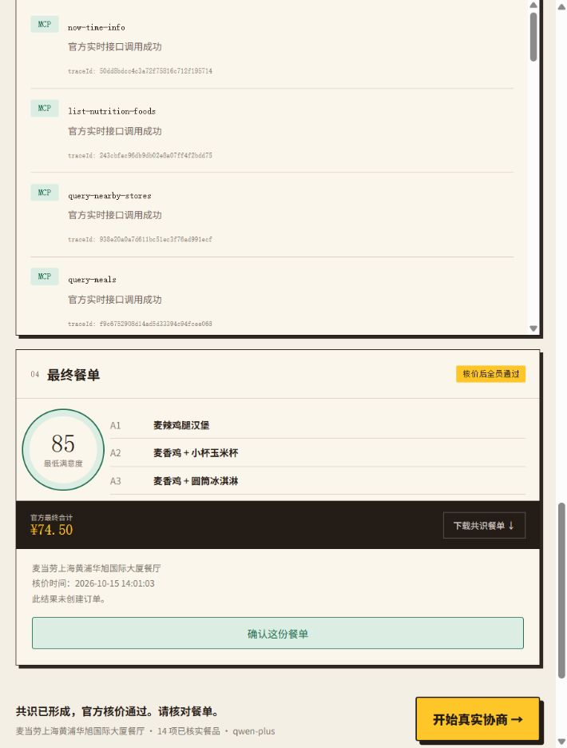
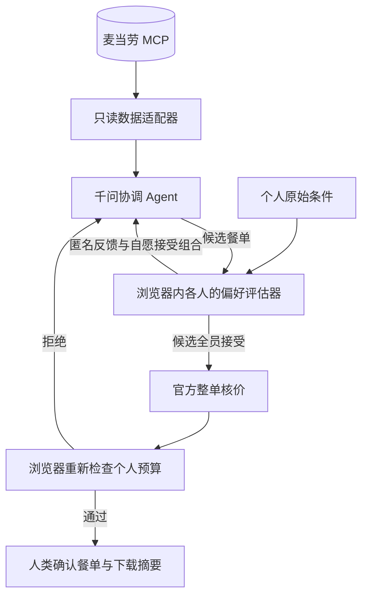

<div align="center">

# 麦麦密桌 · SecretTable

### 每个人只对自己的 Agent 说真话，桌上只看共识。

**隐私保护的多智能体聚餐协商 Skill · 麦当劳中国 MCP · Max–min 公平 · Human-in-the-loop**

</div>

---

**[在线体验：无需 Token 的固定数据演示](https://amazinglh.github.io/mcd-secret-table/)** · **[真实浏览器验收记录](./evidence/BROWSER_QA.md)** · **[模型与 MCP 实测证据](./evidence/live-agent.json)**

在线演示不调用模型、MCP 或交易接口。真实协商请按下文在本机启动，密钥仅保留在本机。



## 实现状态（2026-10-15）

已实现：真实网页与本地 API、大模型协调 Agent、浏览器本地偏好评估、最多三轮反馈协商，以及门店→在售菜单→详情→报价→最终整单核价链路。界面支持编辑每个人的条件、查看真实运行轨迹、确认餐单和下载不含原始条件的摘要。`evidence/live-readonly.json` 是独立 MCP 只读联调记录；`npm run agent:verify` 另行验收真实模型与 MCP 的多轮链路，成功后生成 `evidence/live-agent.json`。

架构为 **1 个千问协调 Agent + 每位参与者 1 个浏览器端规则评估器**，并非多个独立大模型。当前同一浏览器模拟三位参与者，尚未实现多设备身份隔离。闭包、隐藏字段和匿名评分不能提供密码学隐私保证；评分与自愿提供的餐品组合仍可能间接透露偏好。

## 一句话介绍

多人点餐时，预算、忌口和营养目标往往很私人。SecretTable 为每位参与者提供浏览器端偏好评估器；千问协调 Agent 接收匿名评估与自愿提供的可接受组合，结合麦当劳 MCP 的实时菜单与官方核价寻找共识。

> 这不是一个把所有人的偏好收进同一张表的拼单器，而是一套“信息最小化”的多智能体协商协议。

## 为什么值得做

普通多人点餐有三个隐形问题：有人不想公开预算；有人不愿解释具体饮食边界；多数票方案常让一个人默默妥协。SecretTable 的原则是：**私人条件不出本地、硬约束不能被投票覆盖、最低满意度优先提升**。

## 30 秒体验

```bash
npm install
npm run dev
```

打开终端显示的本地地址，选择“真实协商”，编辑共同地点和三位参与者的本地条件，点击“开始真实协商”。

真实模式需要本地环境变量 `MCD_MCP_TOKEN` 和 `DASHSCOPE_API_KEY`。默认模型为 `qwen-plus`，可使用 `QWEN_MODEL` 指定兼容模型；可使用 `DASHSCOPE_BASE_URL` 指定阿里云官方区域端点。调用消耗模型账户额度。密钥只由本地 Node.js 使用，不进入网页。

“离线演示”使用明确标注的固定数据，不需要 Token 或模型密钥，不会自动伪装为真实模式。

```bash
npm test
npm run build
npm start
```

`npm start` 同时提供构建后的网页和实时 API，默认地址为 `http://127.0.0.1:4173/`。单独使用 `npm run preview` 只能预览静态网页，不能运行实时 API。

## 已实现的 Agent 流程

系统职责如下：

1. **MCP 数据适配器**：按固定流程读取营业门店、在售菜单、单品详情、营养和官方价格。当前使用已核实单品子集，不声称覆盖完整套餐或求出全菜单最优解。
2. **端侧偏好评估器**：在浏览器内检查每个人的预算、名称类别偏好、热量与蛋白质边界；未知营养不当作零值通过约束。
3. **千问协调 Agent**：首轮提出多份方案，后续读取匿名接受/拒绝、满意度及少量自愿接受的餐品组合，再调用 `submit_table_proposals` 工具提出修改。
4. **核价与复核**：程序检查商品、人数和公开预算；浏览器按全员接受、最低满意度、平均满意度排序，再调用官方整单核价并重新检查个人条件。

最多三轮；无解或接口失败时直接显示真实状态。模型调用保留 responseId，麦当劳接口保留 traceId。当前不调用任何交易写接口；“确认餐单”仅确认屏幕上的结果，不会下单或付款。

## 核心创新

### 1. 隐私不是“隐藏 UI”，而是协议边界

`createPrivatePreferenceAgent()` 在浏览器里评估个人条件。前端请求明确只发送共同城市、地点、总预算、匿名参与者编号，以及评估结果。第二轮起允许发送少量本地可接受餐品组合及其满意度，帮助协调器收敛。后端拒绝反馈中的额外字段，不接收原始私人预算与偏好。

### 2. 不用平均分掩盖最不满意的人

排序先看全员是否接受，再最大化最低满意度（max–min fairness），最后才比较平均分。这让“两个 95 分 + 一个 10 分”的方案输给“所有人都 75 分”的方案。

### 3. 大模型不猜价格，交易动作不偷跑

真实网页通过本地 API 使用麦当劳 MCP 的菜单与价格；离线模式保持独立标注。模型只能选择已核实商品；超共同预算、遗漏参与者或编造商品的输出会被拒绝。最终餐单须经过 `calculate-price`，若涨价导致个人预算超限则不能确认。只读接口采用允许列表，始终拒绝下单、取消、领券和积分兑换等写操作。

## 架构



## 项目结构

```text
├─ src/
│  ├─ agent/               # 私密 Agent、协调算法、安全门与演示 fixture
│  ├─ App.tsx              # 可交互的公开协商台
│  └─ styles.css           # 响应式视觉系统
├─ server/
│  ├─ mcdClient.ts         # 官方 Streamable HTTP MCP 客户端
│  ├─ liveAgent.ts         # 实时菜单、模型协商、核价与内存会话
│  ├─ model.ts             # 千问工具调用
│  ├─ api.ts               # 同源、只读、流式 HTTP API
│  └─ verify-agent.ts      # 真实 HTTP + 模型 + MCP 验收
├─ tests/                  # 隐私、确定性、公平排序与写操作门测试
├─ SKILL.md                # 可交给 MCP Agent 客户端的技能说明
├─ MCP_INTEGRATION.md      # 工具、流程、安全与业务价值
├─ mcp-config.example.json # 脱敏配置，只含环境变量占位符
└─ CONTEST_DECLARATION.md  # 官方参赛声明，未修改
```

## 真实 MCP 联调

先在 [麦当劳 MCP 开放平台](https://open.mcd.cn/mcp)申请 Token。不要把 Token 粘贴到 Issue、README、截图或公开日志。

若已在 Windows 用户或系统环境变量中配置 `MCD_MCP_TOKEN`，客户端会自动读取，无需重启当前应用。未配置时可在 PowerShell 7 当前会话中输入：

```powershell
$env:MCD_MCP_TOKEN = Read-Host "请粘贴 MCP Token" -MaskInput
```

执行：

```powershell
npm run mcp:inspect
npm run mcp:call -- --tool now-time-info --input '{}'
npm run mcp:verify
npm run agent:verify
```

`mcp:verify` 使用上海人民广场这一固定公共测试地点，不读取用户配送地址、账户或历史订单。`agent:verify` 通过 HTTP API 跑相同的网页数据协议，至少执行两轮真实模型调用，并在最终核价后复核本地合成测试条件；成功才写入 `evidence/live-agent.json`。它验证 API 与端侧算法，不等同于浏览器视觉验收。两种命令都不创建订单、不兑换积分、不领券。

完整接入和工具映射见 [MCP_INTEGRATION.md](./MCP_INTEGRATION.md)。

## 测试关注什么

- 公共 trace 不包含预算、偏好和禁用标签字段。
- 确定性评估器的同样输入得到同样结果；真实大模型生成允许变化。
- 排序遵守“全员接受 → 最低满意度 → 平均满意度”。
- 只读 API 始终不提供下单、取消、领券或积分兑换执行路径。

## 当前边界

- 真实模式实际调用千问和 MCP；离线模式使用 fixture，二者不可混称。
- 当前在一个浏览器中模拟三位参与者；不是多设备安全隔离。
- 只评估已核实单品子集，没有实现套餐替换、优惠券最优组合或完整菜单全局最优。
- 名称推导的类别标签不等于官方配料或过敏原数据，不能用来保证过敏安全。
- 匿名评分和可接受报价存在推断泄漏；不提供零知识证明或密码学隐私承诺。
- 餐品供应、价格和营养信息以麦当劳官方渠道的实时结果为准。

## 目标用户

- 同学聚餐、实验室夜宵、办公室拼单的发起人
- 不愿在群聊中公开预算或具体饮食边界的人
- 希望研究 MCP、多智能体协调、Agent 安全门和可观测性的开发者

## 参赛说明

本项目为麦当劳程序员创意开发大赛参赛作品，由参赛者独立开发，非麦当劳官方产品。项目不包含真实 Token 或个人信息，不构成医疗或营养建议。

## License

源代码采用 MIT License；麦当劳相关商标、品牌素材与服务接口权利归其各自权利人所有。
