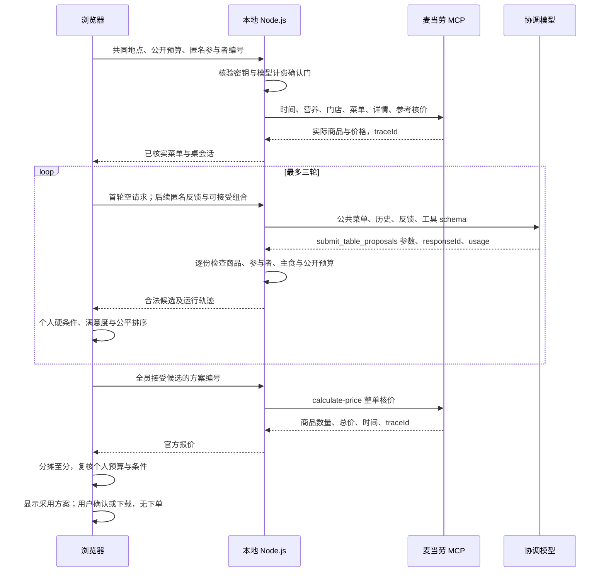

# 技术架构与评分规则

## 1. 技术组成与真实职责

| 层次 | 实际技术 | 职责 |
| --- | --- | --- |
| 网页 | React、TypeScript、Vite、CSS | 条件输入、候选展示、最终确认、餐单下载 |
| 浏览器端评估 | TypeScript 确定性规则、闭包与页面状态 | 检查个人条件、计算分数、生成可接受组合、最终预算复核 |
| 本地服务 | Node.js、HTTP、NDJSON | 同源 API、短期会话、校验、模型/MCP 编排 |
| 大模型 | 百炼 OpenAI 兼容 Chat Completions；当前默认 DeepSeek | 根据公共上下文和匿名反馈生成结构化餐单 |
| 业务工具 | 官方麦当劳 MCP，Streamable HTTP 客户端 | 查询营业门店、菜单、详情、营养与官方价格 |
| Skill | 根目录 SKILL.md | 向可读取技能文件的 Agent 客户端说明任务流程与安全边界 |
| 工程验证 | Vitest、TypeScript 编译、真实只读验收、GitHub Actions | 规则回归、格式与边界检查、构建、静态演示部署 |

项目没有使用 LangChain、LangGraph、向量数据库或训练/微调。没有为了凑技术名词添加不需要的 RAG。MCP 是业务工具访问协议，Skill 是任务说明，Function Calling 是模型给出结构化工具意图的机制，三者不是同一件事。

## 2. 一次真实运行的数据流



MCP 查询顺序由应用代码编排，不是模型自主选择任意 MCP 工具。模型的工具是应用定义的 `submit_table_proposals`：它提出候选餐单，应用验证其参数。两者连接成受约束的“提出 → 反馈 → 修订”循环。

## 3. 模块与 API

| 文件/目录 | 关键职责 |
| --- | --- |
| src/App.tsx | 网页运行状态机、请求编排、候选采用与结果显示 |
| src/agent/negotiator.ts | 个人硬约束、评分与排序 |
| src/agent/localOffers.ts | 在浏览器生成少量本地可接受餐品组合 |
| src/agent/quoteEvaluation.ts | 最终官方报价对应与个人费用复核 |
| src/agent/presentation.ts | 编号补名称、参与者名称和唯一采用标记，仅改变显示 |
| src/agent/transport.ts | 增量解析 NDJSON 数据与轨迹 |
| server/liveAgent.ts | 建桌、模型轮次、历史、候选与报价生命周期 |
| server/model.ts | 模型请求、工具参数解析、计费确认门与额度错误处理 |
| server/validation.ts | 输入允许字段、商品、人数、预算和候选合法性 |
| server/readOnlyPolicy.ts | 明确的 MCP 工具允许列表 |
| server/catalog.ts | 官方菜单适配、名称类别与营养记录匹配 |

接口均仅供本机使用：

| 接口 | 输入/输出 | 约束 |
| --- | --- | --- |
| GET /api/health | 当前模型、调用是否就绪、阻止原因 | 不返回密钥，不调用模型 |
| POST /api/tables | 共同城市/地点/总预算、匿名编号 → 桌与菜单 | 拒绝原始个人字段；先检查模型调用门 |
| POST /api/tables/:id/proposals | 匿名反馈与可接受组合 → 候选 | 每桌最多三轮，反馈须对应上一轮候选 |
| POST /api/tables/:id/quote | 已生成方案编号 → 官方报价 | 不能核价外部任意餐单 |

POST 响应按行发送 `trace`、`table`、`round`、`quote` 或 `error` JSON 消息。这是 NDJSON 增量传输，不是 WebSocket，也不是 SSE 的 `data:` 事件格式。界面随真实返回更新，而不是预先播放一段虚构过程。

会话保存在服务端内存中，TTL 30 分钟，最多 20 桌；进程重启会丢失。个人条件在浏览器页面内存中，刷新会丢失。当前没有数据库持久化和跨设备身份系统。

## 4. 本地评分与排序

对参与者自己的餐品集合，先合计参考价格、热量和蛋白质，并提取类别标签。违反预算、排除类别、必需类别或可选营养条件时为硬失败，满意度记 0。

非硬失败时，代码使用以下启发式公式：

```text
满意度 = round(clamp(18 + 口味分 + 预算分 + 多样性分 + 蛋白质分, 0, 100))

口味分 = 命中偏好类别数 / 偏好类别数 × 38；未设置偏好时为 25
预算分 = clamp((1 - 本人餐品价格 / 本人预算) × 28 + 18, 0, 32)
多样性分 = clamp(餐品去重类别数 × 4, 0, 18)
蛋白质分 = 有非零蛋白质下限时 clamp(实际蛋白质 / 下限 × 12, 0, 12)
           否则为 8

接受 = 未硬失败 且 满意度 >= 55
方案最低满意度 = 所有人满意度的最小值
方案平均满意度 = 所有人满意度的平均值取整
```

这是可解释且可复现的工程启发式，不是经过用户研究标定的真实心理满意度。硬约束不能被高分抵消。候选排序依次比较：全员接受、最低满意度、平均满意度、方案编号。

参考价格可能与最终官方核价不同。最终复核按官方商品明细分摊价格；涉及整除余数时按分处理，不能通过四舍五入隐去支出。无法分摊的额外费用或折扣不会被静默忽略。当前按初筛排序采用第一个通过最终核价的候选，并不宣称最终价格下全局最优。

## 5. 输出与隐私边界

| 数据 | 浏览器处理 | 后端/模型可见 |
| --- | --- | --- |
| 原始个人预算、偏好、营养边界 | 是 | 不直接发送 |
| 共同地点与公开总预算 | 是 | 是 |
| 匿名编号、候选接受/拒绝与分数 | 是 | 是 |
| 自愿接受的少量餐品组合 | 本地产生 | 第二轮起可见 |
| MCP Token、百炼 API Key | 不进入网页 | 仅对应服务请求使用，不放入模型上下文 |
| 候选餐单、商品价格、核价记录 | 是 | 是 |

“原始条件不发送”不等于零泄漏：评分与可接受组合仍可被用于推测偏好。同一浏览器模拟多人的实现，也不能阻止拿到该页面访问权的人切换条件页。闭包不是密码学隔离。

## 6. 失败处理、费用与安全

- 后端逐份严格验证模型候选。附加候选非法时仅淘汰该候选；全部非法才反馈校验错误，在同一模型内最多重试一次，不虚构合格输出。
- 正常一次网页流程最多三轮、每轮最多两次模型请求。用户重新运行会产生新的调用，不属于无限免费额度。
- 每次成功解析的模型响应记录 responseId 和 Token 用量；同一轮的校验重试用量累计。解析失败等历史请求未必都有完整统计，程序数字不等于云端账单。
- 默认离线演示。真实模型调用需 `DASHSCOPE_BILLING_CONFIRMED_MODEL` 与当前模型一致；换模型后重新确认。
- 免费抵扣和按量扣费由百炼管理；本地确认变量不是余额接口。收到 `AllocationQuota.FreeTierOnly` 后停止，不关闭云端保护，不切换另一个付费模型。
- 仅监听本机；检查 Host 和 Origin；限制 JSON 请求体；不向模型发送密钥。
- MCP 工具允许列表始终拒绝下单、取消、领券、兑换等写操作。界面确认仅改变本地状态。
- React 以普通文本渲染模型说明；商品编号映射只在展示层执行，不插入模型返回的 HTML。

官方协议和业务工具说明见 [MCP_INTEGRATION.md](../MCP_INTEGRATION.md)。
