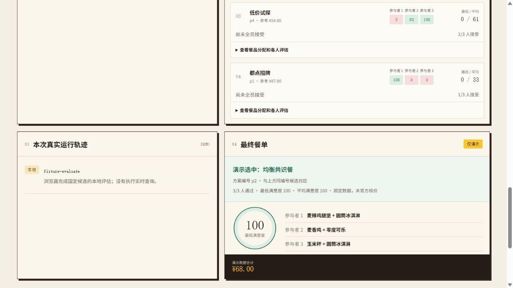

# 网页验收记录

日期：2026-10-15（北京时间）

通过真实浏览器打开 `http://127.0.0.1:5174/`，点击“开始真实协商”。网页读取官方菜单并展示 14 项已核实可选餐品。第一轮没有全员接受的方案，第二轮根据端侧反馈与可接受组合形成共识。

- 模型：`qwen-plus`
- 第一轮模型 responseId：`chatcmpl-9049dc9d-fdb0-9c4a-b0d9-b0ff74040365`
- 第二轮模型 responseId：`chatcmpl-35ef3fdb-b7fa-9bfd-a391-9ad1247db9ed`
- 三位合成本地测试参与者的最终满意度：100 / 98 / 85
- 官方核价：7450 分，即 74.50 元
- 最终官方核价 traceId：`632e4b56d56f3cebc836b5c234f9eb93`
- 官方核价时间：2026-10-15 14:01:03
- 餐单下载成功，文件名 `secret-table-summary.md`
- 点击确认后页面显示“餐单已确认 · 未下单”
- 未执行下单、付款、领券或积分兑换

此记录是一次实际运行结果；不是对每次模型生成或未来价格、供应状态的保证。

## 可解释性更新验收（同日，离线模式）

使用真实浏览器打开 `http://127.0.0.1:4173/`，刷新最新构建后运行默认离线条件。该次 UI 验收没有调用百炼或麦当劳 MCP，不复用历史调用来冒充新的真实运行。

- 候选列表展示 `p2 · 均衡共识餐`，唯一“演示选中”标记对应该编号。
- DOM 核验：`data-selected=true` 的候选数量为 1，其编号为 `p2`。
- 最终餐单显示相同编号 `p2`、方案名称与三人的餐品分配。
- 展开候选，显示餐品编码括号名称、参与者名称、接受状态及分数。
- 展开评分规则，显示硬条件、55 分门槛、最低/平均分排序和参考价/最终价边界。
- 1264 像素宽浏览器视图未发现文档横向溢出。
- 数字官方编号的说明转换由本地测试样例覆盖，不为文案检查额外请求模型。

[完整界面截图](./browser-explainability-demo.png)

